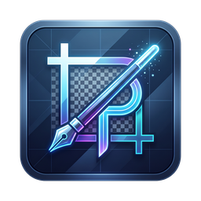

<div align="center">



# LitePhotoEditor

**Лёгкий, быстрый растровый редактор изображений для Windows на гибридной архитектуре C99 + Python (PySide6)**

[](https://www.python.org/)
[](c_core/core_engine.c)
[-41CD52?style=flat-square&logo=qt&logoColor=white)](https://doc.qt.io/qtforpython-6/)
[-005CED?style=flat-square)](https://onnxruntime.ai/)
[](#)

</div>

---

## Ключевые возможности

### Высокопроизводительное C-ядро и минимальное потребление RAM
- **Гибридная архитектура C + Python:** вся пиксельная математика (композитинг, режимы наложения, кисти, фильтры, flood fill, connected components) написана на чистом **C99/C11** с OpenMP-распараллеливанием и скомпилирована в `core_engine.dll`.
- **Zero-Copy `ctypes` + `NumPy`:** указатели на непрерывные `uint8` RGBA-буферы передаются напрямую в C без копирования памяти.
- **Delta Undo/Redo:** вместо клонирования целого холста сохраняется только минимальный `dirty_rect` изменённых пикселей (50 шагов истории при минимальном расходе памяти).
- **Целевой след в простое:** < 80 МБ RAM с открытым пустым холстом.

### Рабочее пространство и навигация (60+ FPS)
- **Многовкладочный интерфейс (`DocumentTabManager`):** только активная вкладка хранит сведённый буфер отображения; неактивные вкладки освобождают кэш, не нагружая память.
- **Zoom-to-Cursor и панорамирование:** плавное масштабирование к курсору, инструмент `Hand (H)` и временный панораминг по `Space + ЛКМ` или средней кнопке мыши из любого инструмента.
- **Магнитная привязка и направляющие:** привязка к краям и осям центра холста (порог 6 экранных пикселей) с чёткими направляющими и временным отключением по `Shift`.
- **Zen Mode (`Tab`):** скрытие всех боковых панелей и меню одним нажатием.

### Слои, маски и режимы наложения
- Полный стек слоёв: создание, дублирование, переупорядочивание, переименование, блокировка, видимость, миниатюры превью, прозрачность (`0–100%`) и `Merge Down`.
- **5 режимов наложения в C:** `Normal`, `Multiply`, `Screen`, `Overlay`, `Add`.
- **Layer Masks & Clipping Masks:** неразрушающие маски слоёв (`uint8`) и обтравочные маски к нижележащему слою.

### Инструменты рисования, ретуши и выделения
- **Кисти (`B`), Ластик (`E`), Палец (`S` — Smudge) и Локальное размытие/резкость (`R` — ядра 3×3 и 5×5)** с интерполяцией мазка и поддержкой масок слоя.
- **Выделение:** Прямоугольная область (`M`), Лассо (`L` — живой полигон), Волшебная палочка (`W` — C flood selection), а также контекстное меню по ПКМ (`Ctrl+J`, `Ctrl+Shift+J`, инверсия, заливка, очистка, кадрирование по выделению).
- **Кадрирование (`C`):** пресеты соотношения сторон (`Free`, `1:1`, `4:3`, `3:4`, `16:9`, `9:16`, `3:2`, `2:3`), кнопка переворота `⇄` и свободный режим по `Shift`.
- **Свободное трансформирование (`Ctrl+T`):** масштабирование (с блокировкой пропорций по `Shift`), поворот, магнитная привязка без двоения исходного слоя и билинейный ресэмплинг.
- **Утилиты:** Пипетка (`I` / `Alt+Клик`), Заливка (`G` с допуском), Линейный градиент (`K`), Текст (`T`).

### ИИ-сегментация, Хромакей и Умная нарезка
- **Lazy AI Background Removal:** `onnxruntime` и модель `u2netp.onnx` (~4.5 МБ) загружаются строго по требованию и немедленно выгружаются из памяти (`del session; gc.collect()`), сохраняя результат в неразрушающую маску слоя.
- **Хромакей в реальном времени:** фильтр в C с пипеткой цвета, допусками, мягкостью краёв и подавлением рефлекса (`Despill`).
- **Grid Splitter & Smart Alpha Splitter:** нарезка по сетке/тайлам или автоматическое выделение спрайтов по альфа-каналу (C `connected_components_alpha`) с интерактивным исключением элементов по клику, экспортом в PNG, **сохранением в `.zip`** или открытием каждого фрагмента в новой вкладке.

### Продуктивность и локализация
- **Drag-and-Drop & Буфер обмена:** перетаскивание файлов на окно/вкладки открывает новые вкладки, а на холст/слои — вставляет отцентрированный слой; `Ctrl+V` поддерживает как скриншоты, так и файлы из Проводника Windows.
- **Быстрый экспорт (`Ctrl+Shift+E`):** форматы `PNG` / `JPEG` / `WEBP`, качество, масштаб (`25%–200%`), живое превью и расчёт веса файла в КБ/МБ в реальном времени.
- **Пакетная обработка (Batch Processor):** многопоточный конвейер операций (`ThreadPoolExecutor`).
- **Двуязычный интерфейс (`RU` / `EN`):** русская локализация по умолчанию с мгновенным переключением через `Вид → Язык`.

---

## Структура проекта

```text
LitePhotoEditor/
├── app/
│   ├── main.py                 # Точка входа, QApplication, AppUserModelID и QSS
│   ├── config/
│   │   ├── i18n.py             # Словари локализации RU / EN
│   │   └── keybindings.json    # Настраиваемые горячие клавиши
│   ├── core/
│   │   ├── c_bridge.py         # Zero-copy ctypes-мост к core_engine.dll
│   │   ├── layer.py            # Модели Layer, LayerMask и BlendMode
│   │   ├── document.py         # DocumentSession, Delta Undo/Redo, DocumentTabManager
│   │   ├── ai_bg_remove.py     # Ленивый ONNX-инференс u2netp и очистка RAM
│   │   ├── splitter.py         # Grid Splitter, Smart Alpha Splitter, ZIP-экспорт
│   │   └── batch.py            # Многопоточная пакетная обработка
│   ├── tools/                  # Инструменты (кисти, навигация, выделение, утилиты)
│   └── ui/                     # CanvasView, панели, диалоги, MainWindow и theme.qss
├── c_core/
│   ├── core_engine.h           # Объявления C API (__declspec(dllexport))
│   ├── core_engine.c           # Реализация на C99 + OpenMP
│   ├── core_engine.dll         # Скомпилированная библиотека (x64, без внешних DLL)
│   └── compile_dll.py          # Автоопределение компилятора (gcc / clang / cl.exe)
├── assets/                     # Иконки (icon.ico, icon_256.png, SVG) и кэш моделей
├── installer/
│   └── setup.iss               # Сценарий установщика Inno Setup 6
├── scripts/
│   ├── build_exe.py            # Генерация иконок, компиляция DLL и сборка PyInstaller
│   └── build_installer.py      # Полный пайплайн сборки LitePhotoEditor_Setup.exe
├── tests/
│   ├── smoke_test_core.py      # Тесты C-ядра, слоёв и Delta Undo/Redo
│   └── smoke_test_full.py      # Сквозные headless-тесты UI, инструментов и диалогов
├── requirements.txt
└── SPEC.md
```

---

## Быстрый старт и сборка

### 1. Установка зависимостей и запуск из исходников

```powershell
python -m venv .venv
.venv\Scripts\activate
pip install -r requirements.txt

# (Опционально) перекомпиляция C-ядра вручную (требуется MinGW gcc / Clang / MSVC)
python c_core/compile_dll.py --force

# Запуск приложения
python -m app.main
```

### 2. Проверка тестов

```powershell
python tests/smoke_test_core.py
$env:QT_QPA_PLATFORM="offscreen"; python tests/smoke_test_full.py
```

### 3. Сборка `.exe` и Windows-установщика

```powershell
# Проверка готовности сборки (без генерации .exe)
python scripts/build_exe.py --check
python scripts/build_installer.py --check

# Сборка автономного приложения в dist/LitePhotoEditor/
python scripts/build_exe.py

# Сборка установщика dist/LitePhotoEditor_Setup.exe (требуется Inno Setup 6: winget install JRSoftware.InnoSetup)
python scripts/build_installer.py
```
